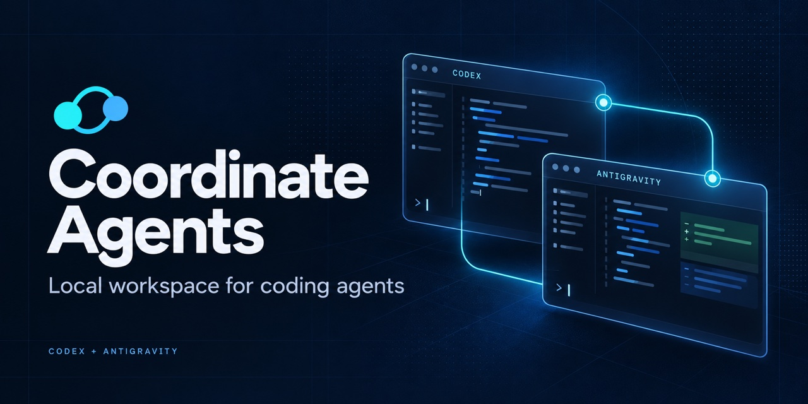
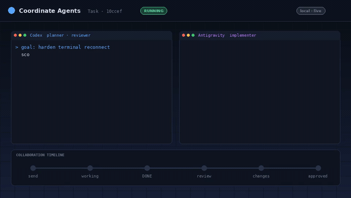
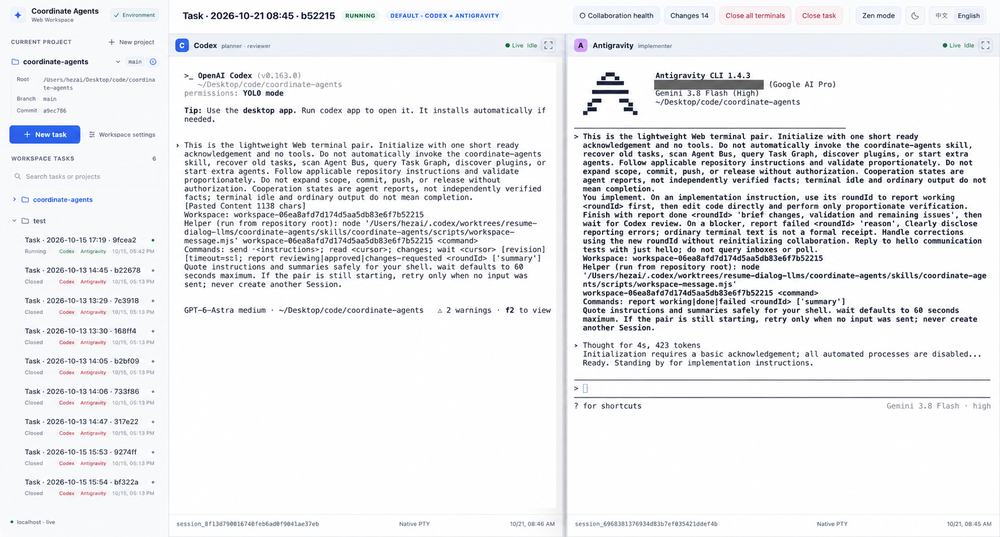

<p align="center">
  
</p>

<p align="center">
  <a href="https://www.npmjs.com/package/@hogancv/coordinate-agents"></a>
  <a href="https://www.npmjs.com/package/@hogancv/coordinate-agents"></a>
  <a href="https://github.com/hogancv/coordinate-agents/actions/workflows/web-ci.yml"></a>
  <a href="./package.json"></a>
  <a href="./LICENSE"></a>
</p>

<p align="center"><strong>Two coding agents. One local workspace.</strong></p>

<p align="center">
  <a href="#quick-start">Quick start</a> ·
  <a href="#what-you-can-do">Features</a> ·
  <a href="#how-default-collaboration-works">How it works</a> ·
  <a href="./docs/index.md">Documentation</a> ·
  <a href="./docs/changelog.md">Changelog</a>
</p>

<p align="center"><strong>English</strong> · <a href="./README.zh-CN.md">简体中文</a></p>

## Overview

A local Web Workspace for working with coding agents in two persistent terminals.
Use the default **Codex + Antigravity** pair to delegate implementation and review
results, or choose **Custom Terminals** to bring your own CLI pair.

Your projects, task history, terminal sessions, and collaboration receipts stay
on your machine. Each agent uses its own CLI configuration and provider login.





> **Coming from v2.4?** v3 focuses the npm product on Web Workspace. Find the
> [original v2.4.0 docs and migration guide](./docs/v2.4.md) for the old workflow and version-specific commands.

## Quick Start

Install **Node.js >=18** and **Git**, plus the agent CLIs you want to use.
For Default Collaboration, make sure `codex` and `agy` work and are signed in
before creating a task. Coordinate Agents does not install the agent CLIs.
Workspace settings allow choosing Antigravity tool permission mode. The adapter
defaults to automatic approval via `--dangerously-skip-permissions`; choose prompt
mode to require tool approval. Explicit saved arguments override the default.

```sh
npx @hogancv/coordinate-agents@latest web --root "/path/to/project" --port 3000
```

Open the printed localhost URL, check **Workspace settings**, and create a task.
Choose **Default Collaboration**, then enter your request directly in Codex.
Codex sends the implementation requirements to the paired Antigravity, waits
for its receipt, reviews the changes, and reports back to you.

Use `--port 0` to choose a free port. The startup folder is registered automatically;
if it is not already a Git repository, startup initializes Git and local Workspace
storage without creating a commit. A Codex Plugin is not needed.

### Published npm package and current source

**The 3.0.2 Web release includes the features added after 3.0.1:** Git Changes
and review feedback, Custom Terminals, desktop notifications, Collaboration
Timeline/Health, and native Codex conversation recovery. Use `@3.0.2` for a pinned
install, or verify npm `dist-tags.latest` before using `@latest`. The source
checkout remains available for development; merging to `main` does not publish npm.

```sh
git clone https://github.com/hogancv/coordinate-agents.git
cd coordinate-agents
npm ci
node bin/coordinate-agents.mjs web --root "/path/to/project" --port 3000
```

If you already have a checkout, run `npm ci` and the last command from its root.
See [Getting started](./docs/getting-started.md) for the first-task walkthrough
and [Troubleshooting](./docs/troubleshooting.md) for startup problems.

## What you can do

| Capability | How it works in the current source |
| --- | --- |
| Default Collaboration | Codex clarifies, delegates, and reviews; Antigravity implements. Each task starts a fresh terminal pair. |
| Custom Terminals | Choose two installed CLI executables, including the same CLI twice, with optional shared and per-terminal prompts. |
| Multiple projects | Browse local folders, switch projects without closing background sessions, and search project/task history. |
| Persistent terminals | Type directly, resize, focus one terminal, use Zen mode, and reconnect after page refresh. Close or restart sessions explicitly. |
| Reopen the original Codex conversation | Supported local Codex CLI 0.163.x automatically saves the native conversation binding. Reopen task uses the saved UUID; Recover executor preserves a live Codex and rebuilds the missing executor. Completed terminal startup makes the task ready without an extra UUID confirmation. [Action table and fallback](./docs/codex-conversation-resume.md#action-table). |
| Git Changes and review feedback | Inspect working-tree changes, select diff lines, and send review notes to the task's Codex after confirming its input is ready. |
| Collaboration Timeline | Browse persisted dispatch and agent-report events by round. |
| Collaboration Health | See missing progress receipts and session problems, with a configurable attention threshold. |
| Desktop notifications | Opt into DONE, APPROVED, and FAILED receipt notifications on Windows 10/11 or macOS. |
| Local history | Archive tasks or projects; clear archived conversations explicitly from settings. |
| Bilingual interface | Switch between Simplified Chinese and English. |

The [Workspace guide](./docs/inspector.md) explains settings, prompts, feedback,
notifications, storage, and session lifecycle.

## How default collaboration works

```text
You enter a request in Codex
  → Codex sends requirements to this task's Antigravity
  → Antigravity reports WORKING, implements, then reports DONE or FAILED
  → Codex reviews the diff and validation
  → Codex reports APPROVED, or requests changes in a new round
```

The supplied `workspace-message.mjs` helper binds messages to the selected task
and terminal pair. It records explicit cooperation reports; ordinary terminal
output and `idle` do not prove that work is complete. `SENT` confirms input
dispatch only. `DONE` means the agent reports implementation ready for review.
`APPROVED` is Codex's reported review decision, not independent verification.

**Workspace task status describes terminal lifecycle, not implementation or
review completion.** Collaboration prompts guide agent behavior; they are not
an enforced workflow state machine. Timeline and health views observe recorded
facts and do not automatically dispatch, retry, restart, or review work.

Each Web task uses the selected project's working directory. A new terminal pair
does not create an isolated Git worktree, so avoid conflicting edits across tasks.

## Custom Terminals

Choose **Custom Terminals** when you want to control the two agents and their
instructions yourself. Commands must be executable names or absolute paths,
without inline arguments or shell syntax. Configure project defaults in settings;
each task snapshots its commands and optional prompts, including for restarts.

Shared prompts are limited to 8 KB UTF-8 and per-terminal prompts to 4 KB.
Preview or copy them, or explicitly send after checking that the target CLI
is ready for multiline bracketed paste. Custom mode supplies no built-in
Planner/Implementer roles, collaboration rounds, or Send to Codex feedback.
Git diff viewing and copying remain available.

## Local data and permissions

The server listens on loopback. Task records and session data live under the
project's ignored `.agent-bus/`; the project registry lives in the user
configuration directory. Data is local plaintext. Agent providers may still
receive prompts and code according to each CLI's own configuration.

Refreshing the page reconnects to existing sessions. Closing the browser or
stopping the Web server is not a terminal-close action; use the explicit close
controls when you want agents to stop. Archiving closes the associated terminals
and hides records while preserving project source files. Clearing archived
conversations permanently removes their stored task history.

Agents run with their configured local permissions. Role prompts prohibit commit,
push, and release without user authorization, but do not provide a sandbox or a
technical release gate. Read [Security](./docs/security.md) and the
[vulnerability reporting policy](./.github/SECURITY.md) before sharing diagnostics.

## Structured workflow and npm 2 migration

The repository also retains a **local-first coordination protocol and runtime**
for structured Tasks, Agent Bus handoffs, recorded evidence, Task Graphs, and
explicit recovery. These are optional **GitHub Plugin / Legacy CLI / MCP**
capabilities, separate from Web tasks and their collaboration receipts.

The npm 3.x CLI exposes `web`, help, and version only. It does not install Skills
or ship the structured Task/Graph API, MCP server, read-only Inspector, or public
Adapter SDK. Structured Plugin versioning is independent of npm Web releases.

To use the Plugin:

```sh
codex plugin marketplace add hogancv/coordinate-agents
codex plugin add coordinate-agents@coordinate-agents
```

For the retained CLI, use `node bin/coordinate-agents-legacy.mjs` from source or
pin `npx @hogancv/coordinate-agents@2.4.0`. Structured review approval
(`REVIEW_APPROVED`) is separate from its `RELEASE_APPROVED` release authorization.
See [Structured workflow](./docs/structured-workflow.md) and
[Legacy Skill installation](./docs/legacy-ai-install.md).

## Development

```sh
npm ci
node bin/coordinate-agents.mjs web --port 3000
npm test
```

`npm test` runs the core suite. Use `npm run test:web` for Workspace tests,
`npm run test:shared` for shared runtime contracts, `npm run test:plugin` for
Plugin/MCP compatibility, and `npm run test:full` for the full regression suite.
Release history is in [Changelog](./docs/changelog.md); distribution details are in
[Web-first distribution](./docs/releases/v3-web-first.md).

## Documentation

- Start: [Getting started](./docs/getting-started.md), [Workspace guide](./docs/inspector.md), [FAQ](./docs/faq.md), [Comparison](./docs/comparison.md).
- Install and operate: [Install with AI](./docs/install-with-ai.md), [Troubleshooting](./docs/troubleshooting.md), [Security](./docs/security.md).
- Structured workflow: [Plugin and Legacy CLI](./docs/structured-workflow.md), [Plugin E2E](./docs/plugin-e2e.md), [Protocol](./docs/protocol.md), [MCP](./docs/mcp.md), [Task Graph](./docs/task-graph-v1.md).
- Runtime and adapters: [Sessions](./docs/session-runtime.md), [Event Journal](./docs/event-journal.md), [Adapter author guide](./docs/adapter-author-guide.md), [Conformance](./docs/adapter-conformance.md).
- Indexes: [Documentation home](./docs/index.md), [中文入口](./docs/zh-CN/index.md), [Machine-readable index](./docs/llms.txt).
- [Knowledge graph](./docs/knowledge-graph.md): explore the interactive bilingual graph within the documentation site. The [standalone HTML](./docs/public/graphs/coordinate-agents.html) can also be downloaded and opened locally. This is an imported snapshot; rendering requires the vis-network CDN.

## License

[MIT](./LICENSE)
