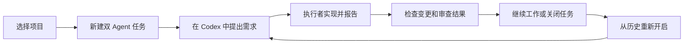
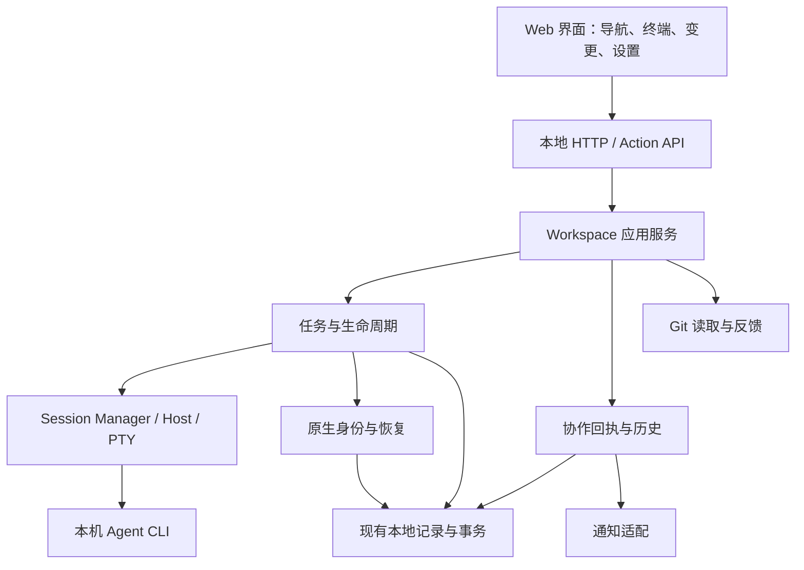

::: info 历史工程记录
本页保留当时的设计、计划或验收依据，适用范围以原文实现阶段为准。旧版本行为、计划中的能力与旧部署方式不能替代[当前使用指南](/zh-CN/inspector.html)和[版本记录](/zh-CN/changelog.html)。
:::

::: warning 历史开发记录
本页保留原始中文技术记录。计划中的版本和能力不代表已发布的 npm 功能；请先查阅[当前版本说明](/zh-CN/changelog.html)。
:::

# Coordinate Agents：本地双 Agent 工作台整体规划

日期：2026-10-21

状态：规划建议稿，供后续迭代取舍；不代表功能已实现或排期已承诺。

代码基线：`f9f02109e2034f379b0e4c56c98664a5393441d1`。

## 1. 产品目标

用户本轮明确选择：**稳定、易用的本地双 Agent 工作台**。

产品定位：让开发者在自己的项目中，使用熟悉的两个 Agent CLI，完成提出需求、协作实现、检查变更和继续历史任务的日常工作。

默认体验围绕 Codex 负责需求与审查、Antigravity 负责实现展开。自定义双终端继续保留，作为使用其他本地 CLI 的轻量入口。

本轮规划采用两个假设：主要服务已使用编码 Agent 的个人开发者；先优化单机工作流。后续若用户群或使用方式改变，再重新评估多人协作与远程运行。

产品价值集中在四件事：

1. 开始工作容易：环境问题有解释，进入双终端后知道在哪里输入。
2. 工作过程可靠：输入、输出、切换项目和重连不会串到其他任务。
3. 中断后能继续：优先保留原 Codex 对话，恢复失败时给出明确下一步。
4. 结果容易检查：协作回执、真实 Git 变更和用户操作各自清楚。

## 2. 现状判断

以下来自本地源码、文档和提交记录。没有在本轮运行产品、回归测试或联网核对 npm 发布状态；历史测试记录不等于当前提交的重新验收。

| 领域 | 当前已有 | 下一步重点 |
| --- | --- | --- |
| 产品入口 | npm Web-first，公开入口为 Web、帮助与版本；结构化能力保留在源码 | 继续围绕一个主入口组织介绍、安装和支持 |
| 工作台 | 双终端、多项目、搜索、主题、聚焦、禅模式、归档 | 串联完整用户流程，提升任务辨识和错误处理 |
| 终端 | 独立 Session Host、PTY、SSE 输出与轮询回退、尺寸调整、重连 | 针对中断、切换、长输出和输入顺序做持续验证 |
| 协作 | 任务绑定通信、轮次、正式回执、时间线、健康提示、通知 | 清楚呈现来源、等待对象和下一步操作 |
| 恢复 | Codex 原生身份绑定、明确 UUID 恢复、执行者局部恢复、旧记录兼容 | 明确能力范围和异常路径，维持恢复流程简洁 |
| 审查 | 工作区 Diff、选行反馈、发送前输入就绪确认 | 补齐常见查看场景，保持变更范围说明 |
| 工程 | Web、Shared、Plugin、Legacy、Package 等测试及 CI 分类 | 按变更影响选择验证，保持分发产物与源码能力一致 |

几个影响整体规划的具体事实：

- 新建 Web 任务仍使用项目工作目录，不自动创建 Git worktree。同项目的多个任务会看到同一份文件。
- 协作 `APPROVED` 是 Agent 的正式回执；终端 `RUNNING` 是生命周期状态，二者含义不同。
- 当前代码已经提供 SSE。后续无需把“改用流式输出”作为新功能立项。
- 当前 `app.js` 为 2,538 行，`workspace-task-runtime.mjs` 为 1,596 行，`session-manager.mjs` 为 1,126 行。职责集中是后续变更的风险点，但行数本身不证明存在缺陷。
- 主 Web 路径已经与 Legacy 入口分开，但仍有大量生产运行时位于 `skills/coordinate-agents/scripts/`。先理清依赖和职责，再决定物理目录迁移。
- `package.json` 标记为 3.0.1。README 记录了截至 2026-10-20 的发布情况，并区分源码新增能力；本规划不将该记录当作当前 npm 实时状态。

**恢复语义应以当前代码为准。** 最新提交已使恢复后的就绪状态取决于当前 Session、运行代次、身份冲突和终端初始化，不再要求正常路径上再次人工确认 UUID。`AWAITING_CONFIRMATION` 仍用于读取历史记录。部分早期设计与验收文档仍描述旧流程，`docs/inspector.md` 也保留了“待确认入口”的说法。近期应明确历史设计与当前使用指南，避免重新引入已经移除的操作步骤。

## 3. 路线选择

| 方案 | 收益 | 代价 | 建议 |
| --- | --- | --- | --- |
| 沿现有工作台逐步完善 | 保留原生 CLI 体验和已积累的恢复机制，较快改善日常使用 | 需要有纪律地拆分复杂模块 | **采用** |
| 重新搭建统一聊天界面或桌面客户端 | 可以重新设计交互 | 会增加 CLI 适配、上下文映射和新宿主维护工作 | 当前不立项 |
| 扩展成通用多 Agent 编排平台 | 可覆盖复杂任务图和调度 | 产品范围、状态模型与支持成本显著扩大 | 保留现有源码能力，等待独立需求 |

近期继续使用 Node.js、ES Modules、xterm 和现有本地存储。框架更换、数据库迁移、桌面封装都应由实际问题驱动。

## 4. 用户流程与界面组织

主路径：

### 4.1 开始任务

- 默认协作作为主要入口；自定义双终端保留为可选择模式。
- 延用现有环境检测，区分命令不存在、终端后端降级、CLI 登录或信任等待。检测到可执行文件不应显示成“已登录”。
- 新任务不增加需求表单，继续直接在 Codex 终端输入。
- 增加轻量任务命名与改名，默认时间标题仍可用。先解决历史难辨认的问题，不引入模型自动命名依赖。

### 4.2 日常工作

- 左侧承担项目、任务和查找；中央保留双终端；右侧按需打开变更或问题详情。
- 顶部保留当前任务、会话状态和关键操作。协作进展单独说明，例如“执行者报告完成，等待审查”。
- 终端连接、协作回执、恢复能力分别展示，不压缩成一个含义混杂的成功徽标。
- Session ID、运行代次和底层错误码进入详情或诊断，主界面优先说明用户能做什么。
- 同工作目录已有活动任务时，在新建入口提示共享文件事实，并允许返回已有任务；活动进程不能被直接认定为正在写文件。

### 4.3 中断与恢复

| 当前事实 | 主要操作 | 应保留的内容 |
| --- | --- | --- |
| 浏览器刷新或暂时断连，原 Session 仍在 | 重连终端 | 原 Session、输入顺序、输出游标 |
| Codex 仍在，执行者退出 | 恢复执行者 | Codex 原会话、任务、历史轮次 |
| 两个终端已关闭且有原生绑定 | 重新开启任务 | 原 Codex UUID、任务 ID、历史记录 |
| 缺少可用绑定 | 展示手工指定原会话入口与原因 | 原任务事实，不默默创建新对话替代 |
| 原生身份冲突或记录不可用 | 解释冲突、提供检查入口 | 原绑定与历史，避免猜测“最近对话” |
| 历史输出已超过保存范围 | 显示截断或缺口 | 真实可用内容，不承诺完整回放 |

采用一个恢复入口，根据事实选择适用动作。正常路径不重新引入 UUID 人工确认。恢复原会话也不等于已持续验证 TUI 身份；能力说明必须与实际观察范围一致。

恢复和重连本身不重发旧实现要求。输入投递结果不确定时，显示不确定事实，由用户或 Codex 决定后续操作。

### 4.4 检查结果

- 继续显示工作区 Diff，并明确它包含用户原有修改，不能自动归属到当前任务或当前轮次。
- 补充有大小限制的未跟踪文本文件预览，保留二进制、大文件和截断说明。
- 保留反馈预览与输入就绪确认；确认应针对本次投递，切换任务或目标后失效。
- 任务归档、终端关闭、Agent 报告完成分别使用明确文案。
- 当前阶段继续由用户在熟悉的 Git 工具中完成提交等操作，避免同时扩大审查界面和 Git 写操作范围。

## 5. 目标架构与模块职责

先建立逻辑边界，在改动相关功能时逐步提取模块。当前文件路径与 `.agent-bus/` 存储保持兼容，不为整理目录一次性改写运行时。

| 模块 | 负责 | 边界 |
| --- | --- | --- |
| Web Shell | 项目和任务选择、布局、设置入口 | 不自行决定后端生命周期是否成功 |
| Terminal Controller | 输入队列、SSE/轮询、游标、尺寸、销毁与重连 | 不根据终端文本判定业务完成 |
| Task Lifecycle | 创建、启动、关闭、重启、恢复、归档 | 统一处理并发动作、所有权和部分失败 |
| Collaboration | 派发与回执校验、轮次、时间线和健康投影 | 展示正式报告，不代替独立结果验证 |
| Native Identity / Resume | UUID 绑定、版本能力、冲突与恢复目标 | 明确绑定证据与当前可观察事实 |
| Review | Git 状态与 Diff、选行、反馈目标校验 | 保持只读查看与显式反馈行为清晰 |
| Storage / Config | 原子写入、锁、记录版本、历史分页 | 延续单一权威记录，不复制出第二套状态 |
| Integrations | CLI 启动、平台 PTY、系统通知 | 显式说明平台和版本支持范围 |

建议拆分顺序：

1. 从 `app.js` 提取终端控制与连接管理，再提取恢复交互、设置和导航；已有独立 Timeline、Changes 等模块继续复用。
2. 从 `workspace-task-runtime.mjs` 分离记录读写/视图投影、启动、恢复、协作命令，原入口先保留为兼容门面。
3. `session-manager.mjs` 仅在相关故障或可测试性需要时继续拆分，保留独立 Host 架构。
4. 逻辑边界稳定后，再评估把共享运行时移出 `skills/`。届时一起更新相对导入、npm 文件白名单和 Plugin 引用，避免出现两份实现。

每次抽取保持对外行为不变，避免与状态语义修改、存储迁移同时发生。

## 6. 状态与数据原则

继续保留不同层次的事实：

- `WorkspaceTask`：用户可找回的工作单元。
- `Session + runtimeGeneration`：某一次受管理的终端进程。
- `CooperationRound`：一次派发与后续正式回执。
- `NativeConversationBinding`：原生对话身份及其证据。

UI 的“需要关注”和“可恢复”从现有记录推导。不要再增加一套独立的持久化“综合任务状态”与它们竞争。

恢复相关规则形成一张可测试的动作表，覆盖：当前终端是否存在、是否完成初始化、原生绑定是否可用、是否冲突、是否已归档、旧操作是否过期。

保留现有任务锁、原子写入和运行代次校验。旧进程、重复点击和迟到响应不应影响新任务或新一代终端。对不确定投递不自动重试，这是可靠性需求，不是通过隐藏提示就能解决的体验问题。

## 7. 迭代路线

按完成条件推进，不先承诺日历日期。正式版本号在核对已发布版本与兼容性后确定。

| 阶段 | 用户能感受到的结果 | 主要交付 | 进入下一阶段的条件 |
| --- | --- | --- | --- |
| M1：可靠性与恢复基线 | 刷新、退出、恢复时知道发生了什么，能继续原任务 | 状态/动作表、关键中断回归、恢复与错误指引、当前使用文档对齐 | 关键流程在声明支持的环境中通过；已知限制可见，无未解释的数据或会话错配 |
| M2：日常使用闭环 | 更快找到任务、理解进展、查看结果 | 任务命名、常用状态筛选、共享目录提示、健康入口改进、未跟踪文本预览 | 从创建到关闭再恢复的完整使用走查通过，用户能区分运行状态与协作报告 |
| M3：维护与分发稳定 | 使用者安装到的能力与说明一致，后续修改风险降低 | 完成必要模块抽取、版本能力清单、更新说明、候选包安装验证 | 从实际候选包完成双终端、恢复和审查流程；旧任务兼容明确 |
| M4：按真实需求扩展 | 支持确实高频的额外工作方式 | 可选任务 worktree 或新增受支持 CLI 配对，分别立项 | 日常使用证据表明现有共享目录或配对能力成为主要阻碍 |

模块拆分随 M1/M2 的相关工作逐步进行，M3 完成剩余边界和分发核对。M1 中独立完成的修复可以先作为补丁候选，不必等后续全部功能结束。

### 第一轮建议做的五个工作包

1. **恢复语义与文档统一**：以当前实现为基线列出动作表，修正现行指南的旧确认步骤；历史方案标记适用版本。
2. **异常流程验收与修复**：检查重复恢复、单边退出、启动中关闭、服务重启、切换任务后的迟到响应。仅对实际失败或覆盖缺口补代码和测试。
3. **恢复操作与错误说明**：统一“重新开启任务 / 恢复执行者”的入口和失败后的操作提示；不增加重复确认。
4. **任务可辨识与共享目录提示**：加入任务改名和必要筛选，在已有活动任务时说明同目录关系。
5. **形成可安装候选**：记录本次新增与已知限制，从候选包验证主流程；发布动作单独执行。

前两个工作包确定行为边界，第三个将它落实到界面，第四个改善日常使用，第五个让成果能稳定交付。M2 中更完整的审查改进可以放入下一轮。

## 8. 验收与成功标准

这些是建议采用的目标，不是当前已达到的成绩，也不把小样本通过率当作线上可用性。

### 必须守住的行为

- 刷新和重连保留原 Session；有界输出缺口能够被识别。
- 切换项目或任务后，旧请求不能向新目标写入。
- 重复点击恢复不创建重复终端；部分成功时保留仍可用的 Codex。
- 明确的原会话恢复沿用原 UUID，不使用最近会话猜测。
- 原执行者退出后，其迟到回执不能修改新执行者负责的轮次。
- 关闭、归档和清理范围明确；项目源文件与保留历史不受误删除。
- 协作状态、进程状态、身份绑定和测试结果分别表达。

### 建议的验证规模

| 目标 | 方法 |
| --- | --- |
| 生命周期稳定 | 在受支持的测试环境中连续进行 20 轮离线创建/关闭/恢复，记录重复 Session、遗留进程、记录丢失等失败 |
| 终端长期可用 | 两小时离线输出与交互场景，包含刷新、resize、连接中断和输出截断，观察资源是否持续增长 |
| 原生会话可继续 | 使用明确支持的 CLI 版本验证原 UUID 恢复与历史上下文可用；离线传输测试与真实模型上下文检查分别记录 |
| 首次使用可理解 | CLI 已安装登录的前提下，从选择项目到进入双终端无需额外配置；登录、信任等外部等待单独记录 |
| 主流程完整 | 人工走查需求输入、正式回执、Diff 反馈、关闭、重新开启；验证下一步操作可以从界面直接找到 |

优先复用现有 Web、Shared、PTY、Resume 和 Package 测试。涉及共享运行时再运行相关 Legacy/Plugin 回归；真实 TUI、原生 PTY、系统通知和各操作系统的证据分别记录。无需每个文案修改都运行全部套件。

诊断默认只留在本地。若增加导出功能，使用固定原因码与最少必要的版本/平台信息，先预览再保存；不为了衡量产品指标新增云端日志服务。

## 9. 范围与延期项

| 项目 | 处理方式 | 重新考虑的条件 |
| --- | --- | --- |
| Plugin / Legacy / MCP / Task Graph | 维护现有使用方式与共享代码兼容，不作为 Web 默认流程 | 有明确独立用户需求 |
| 三个及更多 Agent、自动调度 | 暂缓 | 两个 Agent 已不足以完成高频工作且收益可验证 |
| 自动重试、自动审查闭环 | 暂缓 | 投递与执行结果可可靠判断，并有具体使用需求 |
| 默认每任务 worktree | 暂缓，先提示共享目录 | 并发同项目任务成为常见用法；再设计分支、未提交改动、合并和清理流程 |
| 云同步、账户、多用户、远程终端 | 暂缓 | 单机工作台目标明确扩展 |
| 新前端框架、数据库或桌面宿主 | 按实际问题评估 | 当前方案无法解决已测量的维护、性能或交互问题 |

## 10. 版本与支持策略

- 发布说明围绕可用的用户流程组织，明确“已发布 / 当前源码 / 规划中”。
- CLI 兼容表分别列出：可启动、可交互、自动身份绑定、原生恢复；版本号检测成功不能代替实际能力验证。
- 当前源码声明的 Node 范围和平台回退策略先保持。未来缩小支持范围应基于真实使用与测试成本单独决定。
- Web 是主产品；Plugin 维持独立版本与入口。不要重新把两种任务记录自动混合。
- 候选包验证与发布分开：从包安装成功并跑通主流程后，再执行用户要求的发布操作。

## 11. 主要风险与处理

| 风险 | 处理 |
| --- | --- |
| CLI 升级改变输出、遥测或恢复参数 | 维护能力范围与真实版本验收，未知版本给出明确降级说明 |
| 文档追不上连续行为变更 | 现行使用指南随相关行为更新，历史设计标明已被替代部分 |
| 重构同时修改恢复语义 | 分开提交或工作包，先保留行为，再更改交互 |
| 多任务共享目录造成误解 | 创建时提示并允许返回已有任务；有实际需求再引入隔离 |
| 本地历史长期增长 | 延用有界输出与分页，在真实数据规模下检查加载和清理 |
| 发布版本长期落后于源码 | 缩小候选范围，按已完成流程交付，保持能力清单清楚 |

## 12. 依据与后续使用

关键依据：

- [当前产品说明](https://github.com/hogancv/coordinate-agents/blob/main/README.zh-CN.md)
- [Web-first 设计](./2026-10-08-web-first-v3-design.md)
- [Workspace 使用指南](../../inspector.md)
- [当前原生会话恢复说明](/zh-CN/codex-conversation-resume.html)
- [原生身份捕获与历史验收记录](../../codex-native-auto-binding.md)
- [前端入口](https://github.com/hogancv/coordinate-agents/blob/main/inspector/web-workspace/app.js)
- [任务运行时](https://github.com/hogancv/coordinate-agents/blob/main/skills/coordinate-agents/scripts/workspace-task-runtime.mjs)
- [恢复状态投影](https://github.com/hogancv/coordinate-agents/blob/main/skills/coordinate-agents/scripts/workspace-resume-state.mjs)
- [终端输出流](https://github.com/hogancv/coordinate-agents/blob/main/inspector/web-workspace/terminal-stream.mjs)
- [分发与验证入口](https://github.com/hogancv/coordinate-agents/blob/main/package.json)

本文件用于确定产品方向、模块边界和迭代顺序。开始具体实现时，每个工作包再补充受影响接口、验收场景与实现步骤；优先从 M1 的恢复语义与异常流程开始。
